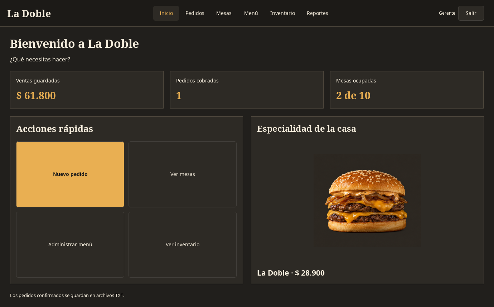
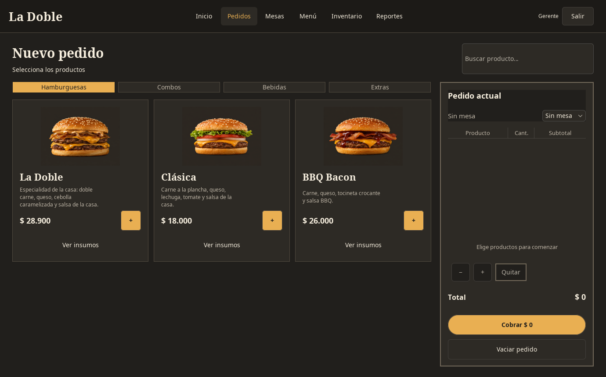
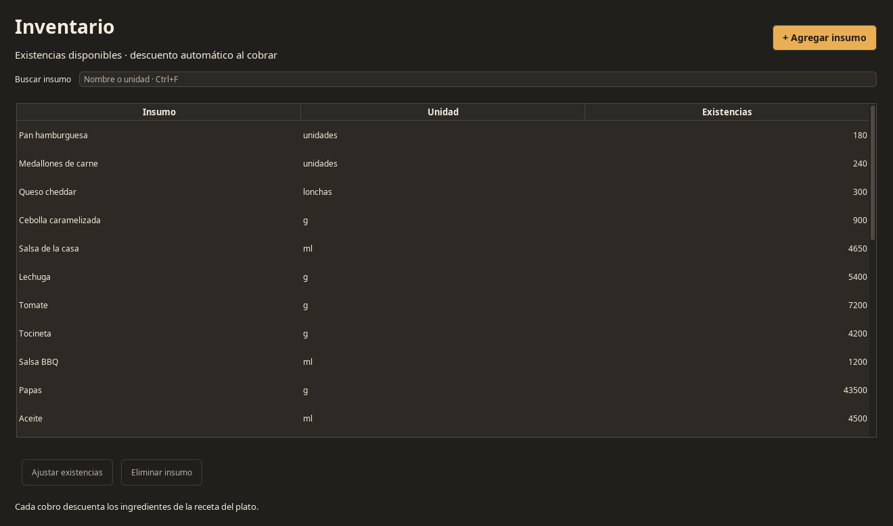

<h1 align="center">La Doble</h1>

<p align="center">
  <strong>Del pedido al cobro, con el inventario al día.</strong><br>
  Gestión de restaurante en Java Swing · Proyecto de aula de Programación II.
</p>

<p align="center">
  <a href="#funciones">Funciones</a> ·
  <a href="#capturas">Capturas</a> ·
  <a href="#ejecutar">Ejecutar</a> ·
  <a href="#desarrollo">Desarrollo</a>
</p>

<p align="center">
  
  
  
  
</p>

<p align="center">
  
</p>

Una aplicación de escritorio para atender mesas, tomar pedidos y registrar ventas. El gerente administra el menú, las recetas y las existencias; cada cobro descuenta los ingredientes utilizados. Diseño en carbón, crema y ámbar, con fotografías de productos y formularios editables en NetBeans.

## Funciones

- **Pedidos y mesas:** catálogo con búsqueda, carrito, cantidades y cobro con confirmación.
- **Menú y recetas:** platos editables e ingredientes definidos por unidad.
- **Inventario:** ajustes de existencias y rechazo de ventas sin insumos suficientes.
- **Reportes:** historial de cobros con fecha, mesa, unidades y precios de venta históricos.
- **Dos roles:** empleado para la atención y gerente para la administración.
- **Guardado local:** archivos TXT con recuperación de pedidos e inventario ante un cobro interrumpido.

## Capturas

<table>
  <tr>
    <td width="50%"></td>
    <td width="50%"></td>
  </tr>
  <tr>
    <td align="center"><em>Pedidos y cobro.</em></td>
    <td align="center"><em>Control de insumos.</em></td>
  </tr>
</table>

<p align="center"><a href="docs/capturas/README.md">Ver todas las pantallas →</a></p>

## Ejecutar

Requiere **JDK 27 o superior** y **Apache NetBeans** con soporte Java Ant.

1. Abrir esta carpeta como proyecto en NetBeans.
2. Seleccionar **Clean and Build** y después **Run Project**.
3. Elegir un rol e ingresar su contraseña de demostración:

| Rol | Contraseña inicial | Acceso |
| --- | --- | --- |
| Empleado | `empleado123` | Inicio, mesas, pedidos y cobro |
| Gerente | `gerente123` | También menú, recetas, inventario y reportes |

Después de compilar, también se puede iniciar desde la raíz:

```sh
java -jar dist/Proyecto-Gestion-Restaurante.jar
```

Para compartir el ejecutable, copiar **todo `dist/`**, incluida su carpeta `lib/`.

### Datos locales

La carpeta `datos/` se crea al iniciar y conserva usuarios, ventas, menú, recetas, inventario y mesas. Está excluida de Git. Para respaldarla, cerrar la aplicación y copiarla; para cambiar las contraseñas de demostración, editar `datos/usuarios.txt` (se guardan en texto plano).

## Desarrollo

**Java Swing + FlatLaf 3.7.2**, con la dependencia incluida en `lib/`. La clase principal es `restaurante.Main`; los formularios `.java` y `.form` están en `src/restaurante/presentacion/`. Las [fotografías y sus prompts](src/restaurante/imagenes/README.md) están incluidas como recursos PNG.

Las clases de prueba están en `test/restaurante/` y tienen su propio método `main`. Cubren permisos, persistencia, recetas, inventario e interfaz, con datos temporales separados de las ventas locales.
