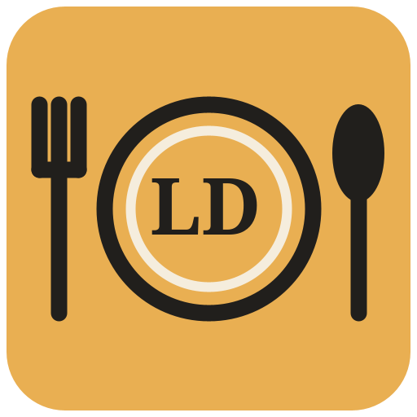
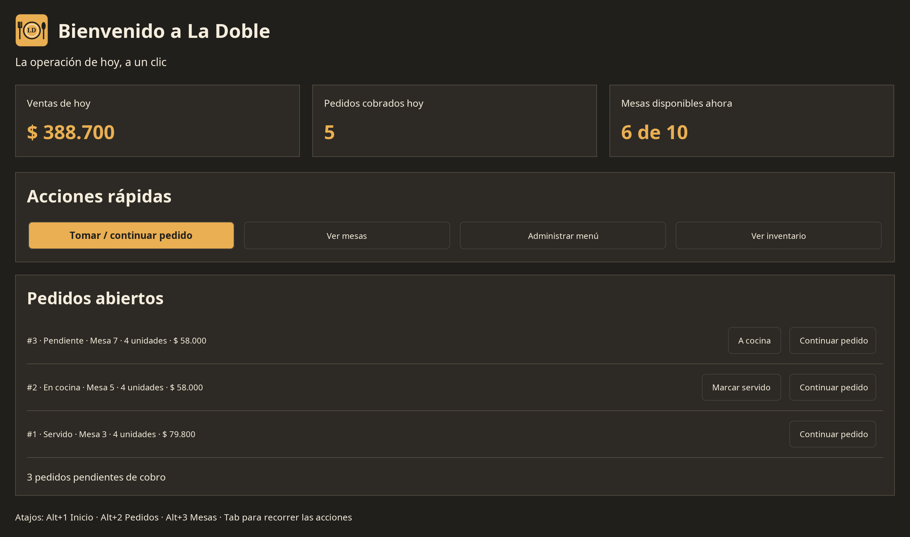
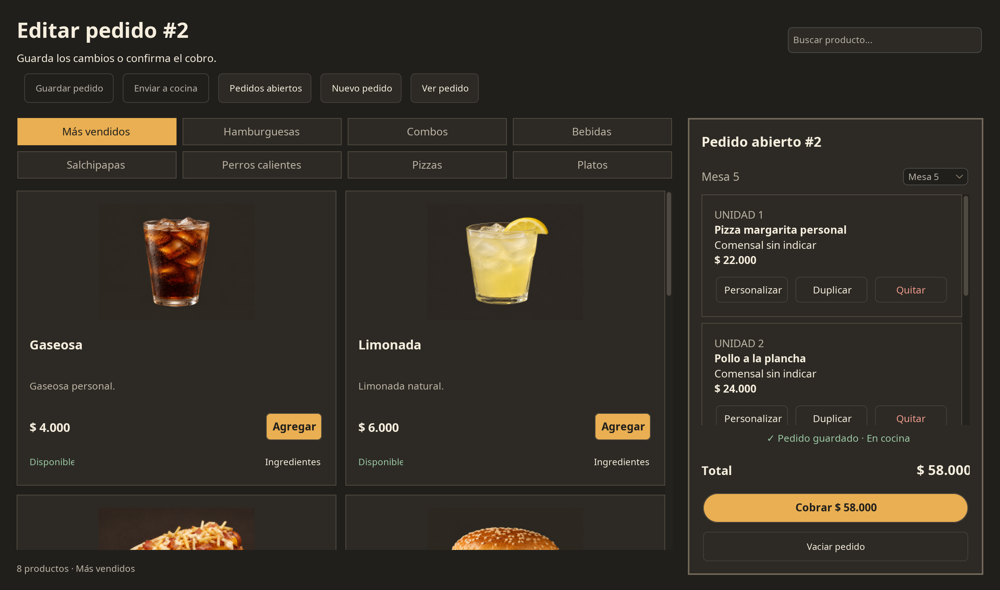
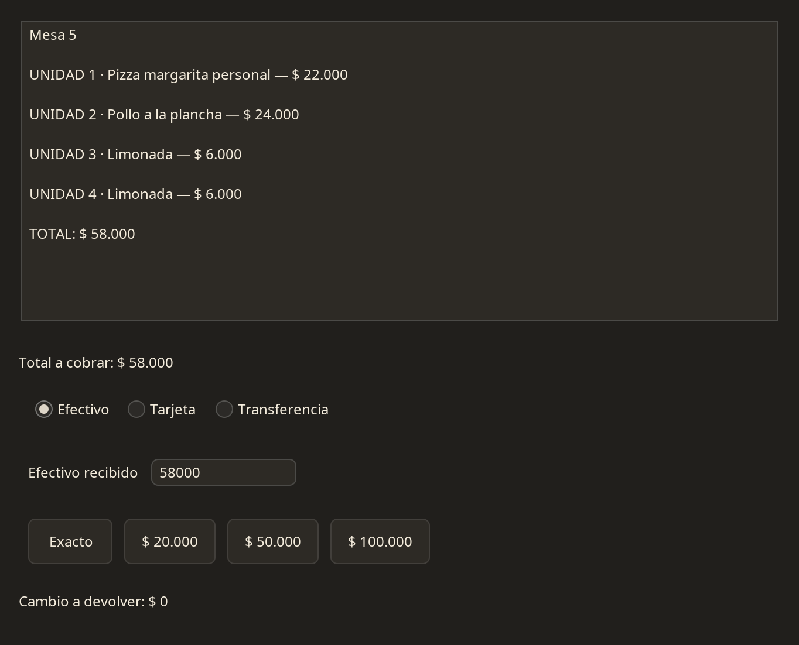
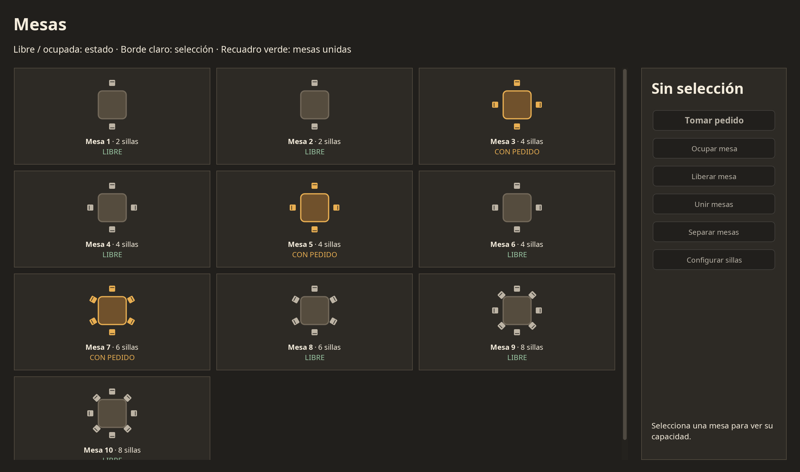
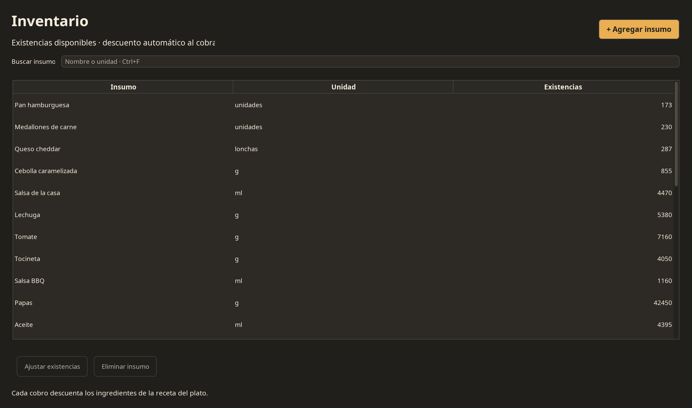

<h1 align="center">La Doble</h1>

<p align="center"></p>

<p align="center">
  <strong>Del pedido al cobro, con el inventario al día.</strong><br>
  Gestión de restaurante en Java Swing · Proyecto de aula de Programación II.
</p>

<p align="center">
  <a href="#funciones">Funciones</a> ·
  <a href="#capturas">Capturas</a> ·
  <a href="#ejecutar">Ejecutar</a> ·
  <a href="#desarrollo">Desarrollo</a>
</p>

<p align="center">
  
  
  
  
  
  
</p>

<p align="center">
  
</p>

Una aplicación de escritorio para atender mesas, tomar pedidos y registrar ventas. El gerente administra el menú, las recetas y las existencias; cada cobro descuenta los ingredientes utilizados. Diseño en carbón, crema y ámbar, con fotografías de productos y formularios editables en NetBeans.

## Funciones

- **Edición de pedidos:** guardar pedidos abiertos, recuperarlos desde la mesa o desde la lista y modificar productos y cantidades antes de cobrar.
- **Preparación por unidad:** cada plato tiene sus adicionales, comensal e indicaciones debajo de su propia línea; permite marcar ingredientes que no debe llevar.
- **Menú ampliado:** salchipapas, perros calientes, pizzas, pollo, carne y ensalada; recetas y existencias iniciales para 30 unidades de cada producto.
- **Mesas y reuniones:** capacidades iniciales de 2, 4, 6 y 8 sillas; el gerente puede ajustar cada mesa entre 1 y 20 sillas. Se pueden unir mesas libres para una misma atención y separarlas después de liberarlas.
- **Identidad del programa:** logotipo escalable dibujado en Java, presente en el acceso, la cabecera y los iconos de las ventanas.
- **Pedidos y cobro:** catálogo con búsqueda, pestaña de **más vendidos**, carrito, cantidades y cobro con confirmación; el inventario se descuenta únicamente al cobrar.
- **Método de pago:** efectivo, tarjeta o transferencia. En efectivo se registra lo recibido y se muestra el cambio antes de confirmar; Reportes indica cómo se pagó cada cobro.
- **Cocina:** "Enviar a cocina" pasa el pedido a preparación; Inicio muestra si cada pedido abierto está pendiente, en cocina o servido y permite avanzarlo.
- **Precios coherentes:** el servicio rechaza cualquier precio que no coincida con el menú, y cada combo cuesta menos que sus artículos por separado.
- **Menú y recetas:** platos editables e ingredientes definidos por unidad.
- **Inventario:** ajustes de existencias y rechazo de ventas sin insumos suficientes.
- **Reportes:** historial de cobros con fecha, mesa, unidades y precios de venta históricos.
- **Dos roles:** empleado para la atención y gerente para la administración.
- **Guardado local:** archivos TXT con recuperación de pedidos e inventario ante un cobro interrumpido.

## Capturas

<table>
  <tr>
    <td width="50%"></td>
    <td width="50%"></td>
  </tr>
  <tr>
    <td align="center"><em>Pedidos: más vendidos y estado de cocina.</em></td>
    <td align="center"><em>Cobro con método de pago y cambio.</em></td>
  </tr>
  <tr>
    <td width="50%"></td>
    <td width="50%"></td>
  </tr>
  <tr>
    <td align="center"><em>Mesas y reuniones.</em></td>
    <td align="center"><em>Control de insumos.</em></td>
  </tr>
</table>

<p align="center"><a href="docs/capturas/README.md">Ver más pantallas →</a></p>

## Ejecutar

Requiere **JDK 17 o superior** (verificado con JDK 27) para compilar mediante la herramienta Java, o **Apache NetBeans** con soporte Java Ant. El código de la aplicación utiliza la API de Java 8. El programa, las pruebas y la herramienta de compilación están escritos en Java; se conserva FlatLaf como biblioteca Java de interfaz.

1. Abrir esta carpeta como proyecto en NetBeans.
2. Seleccionar **Clean and Build** y después **Run Project**.
3. Elegir un rol e ingresar su contraseña de demostración:

| Rol | Contraseña inicial | Acceso |
| --- | --- | --- |
| Empleado | `empleado123` | Inicio, mesas, pedidos y cobro |
| Gerente | `gerente123` | También menú, recetas, inventario y reportes |

Después de compilar, también se puede iniciar desde la raíz:

```text
java -jar dist/Proyecto-Gestion-Restaurante.jar
```

Para compartir el ejecutable, copiar **todo `dist/`**, incluida su carpeta `lib/`.

### Datos locales

La carpeta `datos/` se crea al iniciar y conserva usuarios, ventas, menú, recetas, inventario y mesas. Está excluida de Git. Para respaldarla, cerrar la aplicación y copiarla; para cambiar las contraseñas de demostración, editar `datos/usuarios.txt` (se guardan en texto plano).

## Documentación

- [Índice de documentación](docs/README.md).
- [Informe del proyecto de aula (PDF)](docs/informe/INFORME_PROYECTO.pdf).
- [Guía de uso](docs/guias/USO.md).
- [Diagrama de clases editable](docs/diagramas/clases.puml).
- [Diagrama de paquetes editable](docs/diagramas/paquetes.puml).

### Compilar y probar desde terminal

```text
java herramientas/Proyecto.java compilar
java herramientas/Proyecto.java probar
java herramientas/Proyecto.java probar-ui
```

`probar` ejecuta las suites de datos, inventario, controlador, consola y paneles Swing sin pantalla con archivos temporales. `probar-ui` requiere escritorio y comprueba también ventanas y diálogos.

Para retirar los archivos temporales de compilación y las capturas de prueba:

```text
java herramientas/Proyecto.java limpiar
```

El comando elimina `build/`. La siguiente compilación regenera esa carpeta. El ejecutable de distribución está en `dist/`; las capturas documentales están en `docs/capturas/`.

### Modo consola

```text
java -jar dist/Proyecto-Gestion-Restaurante.jar --consola
```

Permite autenticarse, consultar el menú, gestionar mesas, cobrar y realizar las operaciones administrativas según el rol. Usa los mismos controladores y servicios que Swing. Para una demostración separada de los datos habituales:

```text
java -Drestaurante.datos=/tmp/la-doble-demo -jar dist/Proyecto-Gestion-Restaurante.jar --consola
```

## Arquitectura

Las vistas de `presentacion/` llaman a los controladores de `controlador/`. `ServicioRestaurante` concentra permisos, validaciones y consumo de ingredientes. `RepositorioRestaurante` define el contrato que implementa `DatosRestaurante` para archivos TXT. `entidades/` contiene el dominio y `seguridad/` gestiona credenciales y sesiones. `Main` construye e inyecta estos componentes.

## Desarrollo

### Organización de carpetas

```text
restaurante/
├── src/                  Código Java, formularios y recursos de la aplicación
├── test/                 Pruebas Java
├── herramientas/         Compilación, pruebas y limpieza desde Java
├── lib/                  FlatLaf
├── nbproject/            Configuración compartida de NetBeans
├── datos/                Datos locales y respaldo de migración
├── dist/                 Ejecutable y biblioteca para distribuir
├── assets/               Capturas del README
└── docs/
    ├── README.md         Índice de documentación
    ├── informe/          Informe del proyecto de aula y rúbrica
    ├── guias/            Guías de uso
    ├── capturas/         Pantallas del programa
    ├── diagramas/        Modelos UML y sus imágenes
    └── identidad/        Logotipo
```

`build/` y `nbproject/private/` son carpetas locales regenerables. `build.xml` y `manifest.mf` se mantienen en la raíz para abrir y compilar el proyecto con NetBeans.

**Java Swing + FlatLaf 3.7.2**, con la dependencia incluida en `lib/`. La clase principal es `restaurante.Main`; los formularios `.java` y `.form` están en `src/restaurante/presentacion/`. Las fotografías de los productos están incluidas como recursos PNG en `src/restaurante/imagenes/`.

Las clases de prueba están en `test/restaurante/` y tienen su propio método `main`. Cubren permisos, persistencia, recetas, inventario e interfaz, con datos temporales separados de las ventas locales.

## Créditos

- [FlatLaf](https://www.formdev.com/flatlaf/) (Apache 2.0) para el aspecto de la interfaz Swing.
- Proyecto de aula de Programación II.

## Licencia

[MIT](LICENSE).
