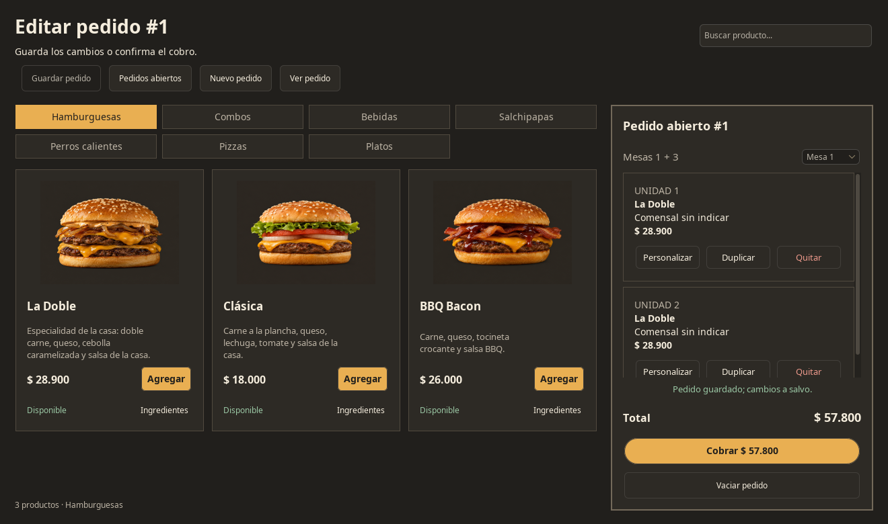
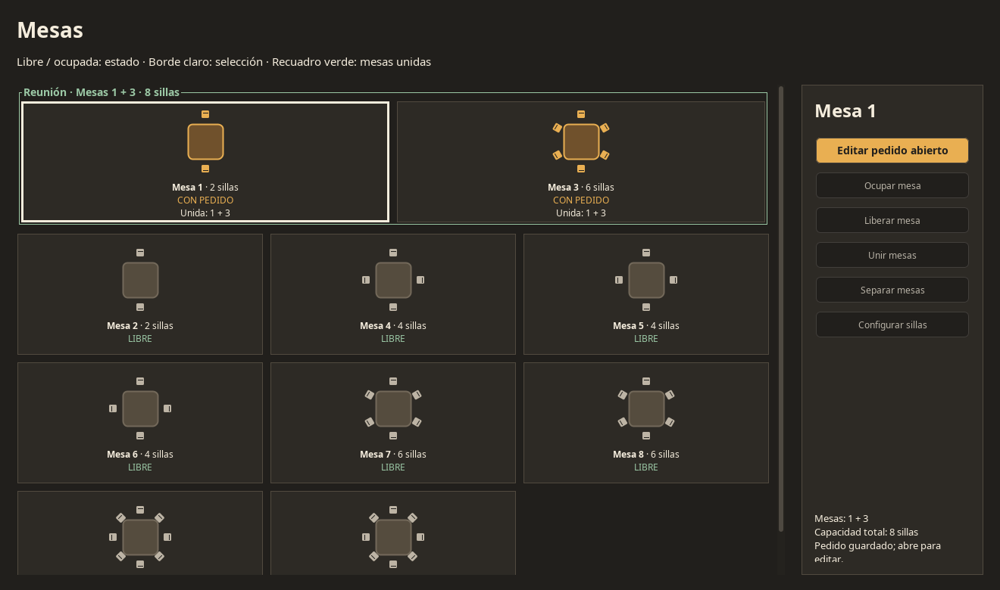

# Pedidos abiertos, sillas y reuniones

Estas funciones están implementadas en Java, con la interfaz FlatLaf existente. El logotipo y los iconos de mesas se dibujan mediante Java2D.

## Editar un pedido

1. Selecciona una mesa en **Mesas** y pulsa **Tomar pedido**, o inicia un pedido sin mesa desde **Pedidos**.
2. Agrega los productos y ajusta las cantidades. Pulsa **Guardar pedido** para conservar la atención sin cobrarla.
   Cada unidad se registra por separado. **Personalizar** permite asignar sus propios adicionales, comensal e ingredientes que no llevará; **Ver pedido** muestra la comanda completa.
3. Pulsa **Nuevo pedido** para atender a otra persona. El pedido guardado permanece disponible aunque cierres sesión o el programa.
4. Recupera la atención desde **Pedidos abiertos** o seleccionando cualquiera de sus mesas y pulsando **Editar pedido abierto**.
5. Añade productos, aumenta o reduce cantidades, o quita líneas. Pulsa **Guardar pedido** para conservar la nueva versión.
6. Pulsa **Cobrar** para confirmar la venta de la última versión del carrito. En ese momento se valida el stock y se descuentan los insumos una sola vez.

**Vaciar pedido** permite cancelar una atención guardada con confirmación. La cancelación no crea una venta ni consume ingredientes. La mesa permanece ocupada hasta que se libere expresamente.

Los pedidos cobrados conservan su historial; esta función edita las atenciones previas al cobro. El pedido guardado conserva su mesa o grupo: para otra mesa se inicia una atención nueva. Los cambios locales sin guardar se protegen antes de cambiar de mesa, iniciar otro pedido o cerrar sesión. Los pedidos abiertos no reservan existencias; si falta stock al cobrar, la atención sigue disponible para corregirla.



## Sillas por mesa

La distribución inicial es de 2, 4, 6 y 8 sillas. En **Mesas**, el gerente selecciona una mesa libre y pulsa **Configurar sillas**. Se permite una capacidad de 1 a 20 sillas por mesa física. La tarjeta actualiza tanto el número como el dibujo de las sillas. El empleado puede consultar las capacidades.

## Unir mesas para una reunión

1. Antes de ocupar las mesas, selecciona una mesa libre y pulsa **Unir mesas**.
2. Marca las mesas que se van a juntar y confirma. Si alguna ya forma parte de un grupo libre, se incluye todo ese grupo.
3. Cada tarjeta identifica las mesas unidas. El panel lateral muestra la capacidad total, sumando sus sillas.
4. Selecciona cualquier mesa del grupo y toma el pedido. Guardar la atención ocupa todo el grupo; desde cualquiera de sus mesas se recupera el mismo pedido.
5. Después de cobrar o cancelar el pedido, pulsa **Liberar mesa** para liberar el grupo completo.
6. Pulsa **Separar mesas** para volver a administrarlas individualmente. Cada mesa conserva su capacidad.

Se rechazan mesas repetidas, inexistentes u ocupadas al unir. No se permite liberar o separar un grupo con un pedido abierto. Los reportes conservan los números de todas las mesas atendidas aunque después se separen.



## Logotipo

El símbolo de La Doble representa un plato y cubiertos con la paleta ámbar, carbón y crema. Está integrado en el acceso, la cabecera, Inicio y los iconos de las ventanas. Su fuente editable es `src/restaurante/presentacion/Logotipo.java`; no requiere un generador externo.


## Archivos y compatibilidad

- `mesas.txt` guarda `numero|ocupada|sillas|grupo`. También se leen los registros anteriores `numero|ocupada` y se les asignan las capacidades iniciales.
- `pedidos_abiertos.txt` guarda las atenciones pendientes y sus detalles.
- `pedidos.txt` conserva ventas con su precio y las mesas atendidas; se admiten las cabeceras antiguas.
- El diario `cobro_pendiente.txt` permite recuperar juntos ventas, inventario, pedidos abiertos y mesas si un guardado se interrumpe.

Las mismas operaciones están disponibles en la consola: opciones 12 a 19 para listar, guardar, editar, cobrar y cancelar abiertos, unir o separar mesas y configurar sillas según el rol.

Para compilar y verificar:

```text
java herramientas/Proyecto.java probar
```

La suite de ventanas y diálogos requiere un escritorio:

```text
java herramientas/Proyecto.java probar-ui
```
