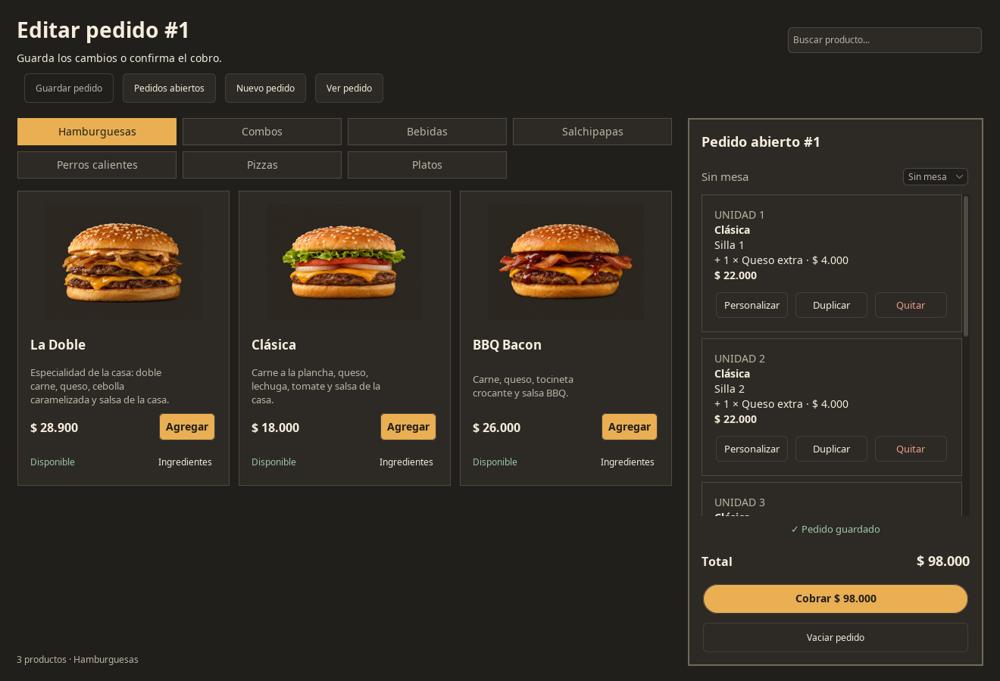

# Menú de restaurante y pedidos por unidad

El programa conserva Java y FlatLaf. El logotipo ahora representa un plato con cubiertos, sin la hamburguesa del símbolo anterior.

## Diez productos nuevos

| Código | Producto | Precio de demostración |
| --- | --- | ---: |
| S001 | Salchipapa clásica | $17.000 |
| S002 | Salchipapa especial | $24.000 |
| P001 | Perro caliente clásico | $14.000 |
| P002 | Perro caliente especial | $20.000 |
| Z001 | Pizza margarita personal | $22.000 |
| Z002 | Pizza pepperoni personal | $26.000 |
| Z003 | Pizza hawaiana personal | $25.000 |
| D001 | Pollo a la plancha | $24.000 |
| D002 | Carne a la plancha | $28.000 |
| D003 | Ensalada de la casa | $14.000 |

El catálogo muestra siete categorías de productos principales. Los adicionales se administran desde Menú, pero se seleccionan únicamente al personalizar una unidad del pedido. Se mantienen los códigos anteriores de papas, tocineta y queso extra para conservar referencias e historial.

## Tomar un pedido sin ambigüedades

1. Cada clic en un producto agrega una unidad independiente. Cinco clics en Clásica crean cinco preparaciones numeradas, aunque tengan el mismo precio.
2. Pulsa **Personalizar** dentro del bloque de la unidad que deseas modificar.
3. Indica el comensal o la silla si necesitas identificar a quién se sirve.
4. Elige las porciones de adicionales para esa unidad; 0 significa no incluir el adicional.
5. Marca los ingredientes que esa unidad NO llevará, como **Sin Tomate**. Esta selección modifica el consumo real de la receta. Las observaciones libres son instrucciones de preparación y no sustituyen las casillas de ingredientes.
6. Agrega otras indicaciones y confirma. Los adicionales e indicaciones aparecen debajo del producto correspondiente.
7. Usa **Ver pedido** para revisar la comanda completa; al cobrar se presenta nuevamente el detalle por unidad.

En el carrito, la fila principal muestra el importe base y sus filas de adicionales muestran los incrementos. El total general incluye cada cargo una sola vez. Retirar un ingrediente no reduce el precio de venta del plato.

### Ejemplo solicitado

```text
1. Clásica — Silla 1
   + Queso extra x1
2. Clásica — Silla 2
   + Queso extra x1
3. Clásica — Silla 3
   SIN Tomate
4. Clásica — Silla 4
5. Clásica — Silla 5

Total: 5 × $18.000 + 2 × $4.000 = $98.000
```

El cobro consume cinco panes, cinco medallones, siete lonchas de queso (cinco de base y dos adicionales) y tomate para cuatro hamburguesas. Guardar y recuperar el pedido conserva todas esas asociaciones. En **Reportes**, **Ver detalle por unidad** permite consultarlas después del cobro.



## Existencias para 30 unidades de cada producto

Se calcularon los 27 insumos sumando las recetas de todo el menú, para cubrir simultáneamente 30 unidades de cada uno de los 19 productos principales y 30 porciones de cada uno de los tres adicionales. Las cantidades completas están en `src/restaurante/config/inventario.txt`.

Por ejemplo: 180 panes de hamburguesa, 60 panes de perro, 180 salchichas, 90 bases de pizza, 12.300 g de mozzarella y 43.500 g de papas. Las porciones son las definidas en las recetas de demostración, no medidas obtenidas de un restaurante real.

La ampliación se aplica una sola vez a los datos existentes. Antes de modificar el menú, las recetas y el inventario, se copian sus archivos en `datos/.respaldo-menu-restaurante-v3/`. Se conservan precios personalizados e insumos propios y se completa la reserva necesaria. Las ventas, las mesas y las credenciales anteriores no se sustituyen.

La marca `datos/menu_restaurante_v3.txt` evita que cerrar y abrir el programa reponga automáticamente los insumos consumidos. La reposición posterior sigue correspondiendo al gerente desde Inventario.

## Validación y persistencia

Los adicionales tienen que pertenecer a un plato; no se aceptan como productos independientes ni se asignan a bebidas. Cada unidad personalizada tiene cantidad 1. Se rechazan adicionales repetidos, cantidades fuera de 1 a 5, ingredientes ajenos a la receta, retirar la receta completa e instrucciones contradictorias como solicitar queso extra y marcar Sin Queso cheddar.

Los archivos de pedidos conservan el producto, comensal, observaciones, adicionales y exclusiones. Cada registro adicional u omisión identifica el índice del producto al que pertenece. Se mantienen la lectura de los registros antiguos y los precios históricos.

La consola ofrece la opción **20**, que personaliza una unidad de un pedido abierto y muestra los adicionales dentro de ese contexto.

La suite `PersonalizacionesTest` comprueba el ejemplo completo, la comanda, el guardado, el reinicio, la migración con respaldo y el agotamiento de existencias después de vender 30 de cada producto.

Consulta los controles − / +, el resumen en vivo y los atajos en [Interfaz y flujo de atención](INTERFAZ_Y_FLUJO.md).
