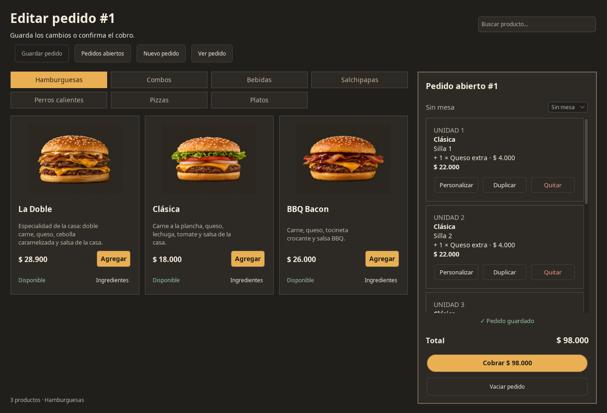
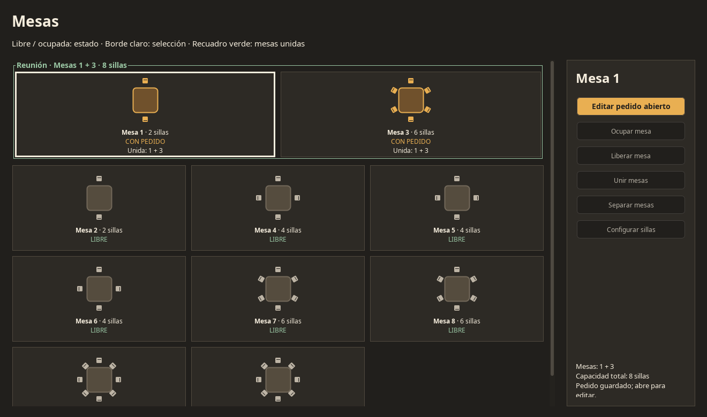

# Guía de uso de La Doble

## Guardar y retomar un pedido

1. En **Mesas**, selecciona una mesa y pulsa **Tomar pedido**. También puedes iniciar una atención sin mesa desde **Pedidos**.
2. Agrega los productos y pulsa **Ver pedido** para revisar la comanda. **Guardar pedido** conserva la atención aunque cierres la sesión o el programa.
3. Pulsa **Nuevo pedido** para atender a otra persona. Para recuperar una atención, selecciónala en **Pedidos abiertos**, pulsa **Continuar** en Inicio o usa **Editar pedido abierto** desde una de sus mesas.
4. Después de editar, vuelve a guardar. **Enviar a cocina** guarda el pedido y lo marca en preparación. Desde Inicio puedes avanzar su estado hasta servido.

**Vaciar pedido** permite cancelar una atención guardada previa confirmación. La mesa permanece ocupada hasta que se libere. Los pedidos abiertos no reservan existencias.

## Personalizar una unidad

1. Cada clic en un producto agrega una unidad independiente. Pulsa **Personalizar** dentro de la unidad que deseas modificar.
2. Indica el comensal o la silla, elige hasta cinco porciones de cada adicional y marca los ingredientes que se deben retirar. Las casillas de exclusión modifican el consumo de la receta. Usa las observaciones para otras instrucciones de preparación.
3. Revisa el subtotal antes de aplicar. **Duplicar** copia la unidad con sus cambios. **Quitar** elimina solo la unidad seleccionada.

## Cobrar y consultar la venta

Pulsa **Cobrar** y selecciona efectivo, tarjeta o transferencia. En efectivo, indica cuánto recibiste y revisa el cambio antes de confirmar. El cobro vuelve a comprobar las existencias y descuenta los insumos al registrar la venta.

El gerente puede filtrar el historial por fechas en **Reportes** y abrir **Ver detalle por unidad** para consultar los adicionales, las exclusiones y las indicaciones del pedido. En **Inventario** puede buscar por nombre o unidad y ajustar existencias.

## Unir mesas y configurar sillas

1. Selecciona una mesa libre, pulsa **Unir mesas**, marca las demás mesas libres y confirma. El panel lateral muestra la capacidad total.
2. Toma o retoma el pedido desde cualquiera de las mesas del grupo. Después de cobrarlo o cancelarlo, pulsa **Liberar mesa** para liberar el grupo completo.
3. Pulsa **Separar mesas** cuando el grupo esté libre. Cada mesa conserva su capacidad. El gerente puede usar **Configurar sillas** para asignar de 1 a 20 sillas a una mesa libre.

## Atajos

| Tecla | Acción |
| --- | --- |
| Alt+1 / Alt+2 / Alt+3 | Inicio / Pedidos / Mesas |
| Ctrl+F | Buscar en Pedidos, Menú o Inventario |
| Enter en la búsqueda de Pedidos | Agregar el primer resultado disponible |
| Ctrl+S en Pedidos | Guardar si hay cambios y productos |
| Tab / Mayús+Tab | Recorrer controles y acciones |
| Ctrl+E / Ctrl+D / Supr dentro de una unidad | Personalizar / Duplicar / Quitar esa unidad |
| Ctrl+E en la tabla de Menú | Editar el plato seleccionado |
| Escape en la personalización | Cancelar sin aplicar |

Consulta las [capturas de la aplicación](../capturas/README.md) y las [instrucciones para ejecutar Swing o la consola](../../README.md#ejecutar).
