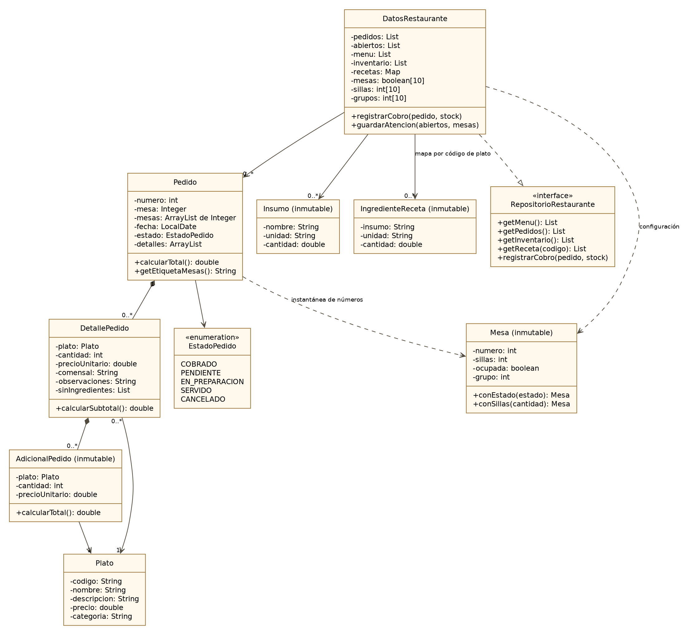
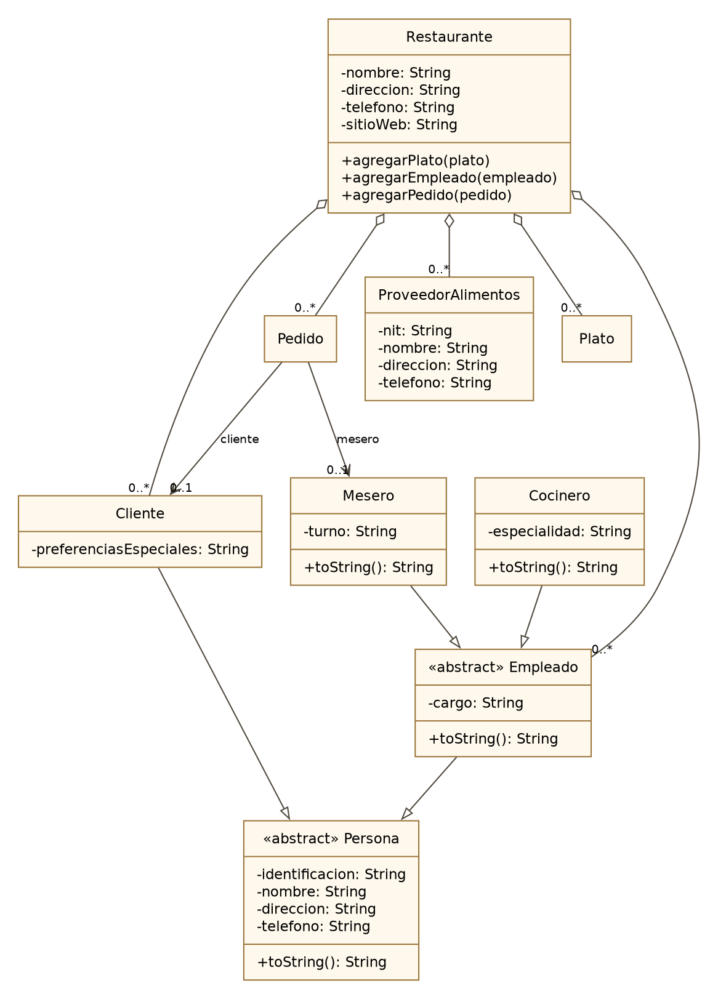
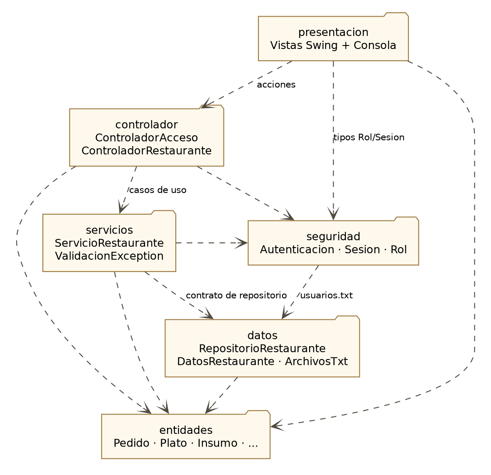
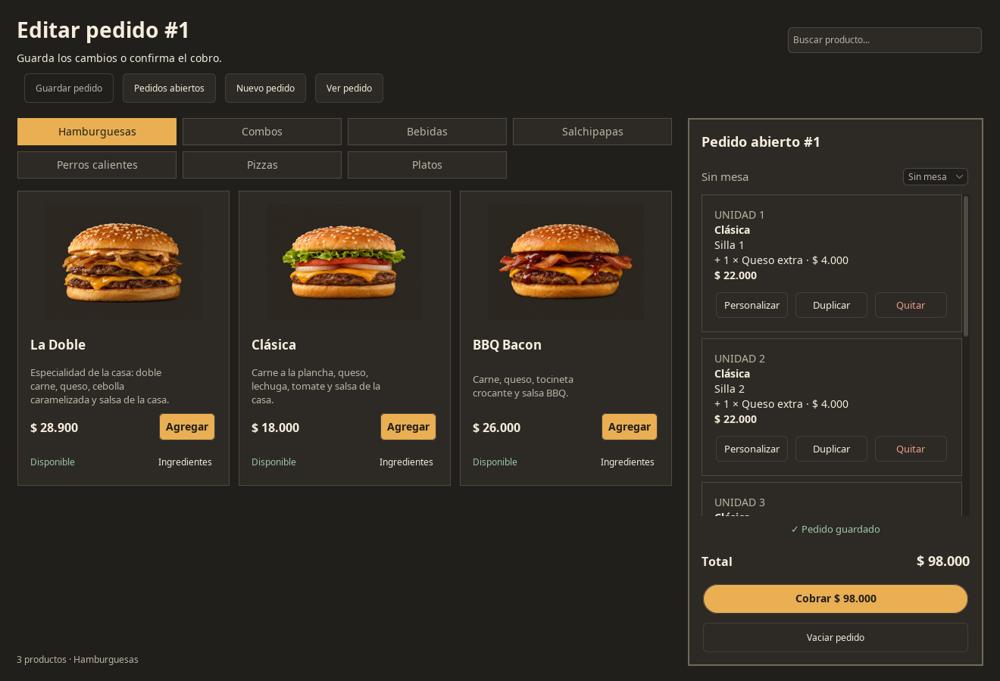
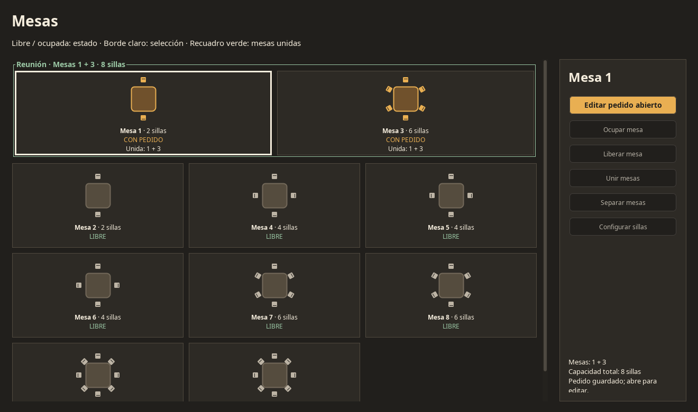

# La Doble

## Sistema de gestión de restaurante

**Informe del proyecto de aula - Programación II (SS300)**

Del pedido al cobro, con el inventario al día.

- Institución: por definir por el equipo.
- Integrantes: por definir por el equipo.
- Docente y grupo: por definir por el equipo.
- Fecha de entrega académica: por definir por el equipo.
- Fecha de revisión técnica: 12 de noviembre de 2026.
- Tecnologías: Java, Swing, FlatLaf y archivos TXT UTF-8.

**Estado del documento:** informe técnico preparado para revisión. Los datos de portada, responsables, fechas de entrega y evidencias de la sustentación se completarán posteriormente. No se afirma que ya se haya efectuado una entrega o exposición académica.

<!-- page -->

# Contenido

1. Planteamiento del problema, causas, efectos y aplicaciones.
2. Estado del arte y vigilancia tecnológica.
3. Descripción de la solución, alcance y factor diferenciador.
4. Requisitos funcionales y criterios de aceptación.
5. Control de acceso.
6. Diseño y programación orientada a objetos.
7. Diagrama de clases del dominio.
8. Arquitectura por capas, MVC y diagrama de paquetes.
9. Diseño de interfaz y experiencia de usuario.
10. Persistencia en archivos.
11. Validación, excepciones y código limpio.
12. Código desarrollado y ejecución en consola.
13. Verificación y matriz de cumplimiento.
14. Exposición y demostración del software.
15. Dominio del proyecto: preguntas y respuestas.
16. Organización del trabajo y cumplimiento de entregas.
17. Referencias.

Este informe describe el comportamiento implementado y enlaza los archivos que permiten revisarlo. La [rúbrica de referencia](RUBRICA.md) se conserva junto al informe. Las actividades humanas de presentación, distribución de responsabilidades y entrega se distinguen de las funcionalidades verificables del software.

<!-- page -->

# 1. Planteamiento del problema

## 1.1 Problema central

En el escenario de un pequeño restaurante con una carta variada, llevar los pedidos, la ocupación de mesas y las existencias en registros independientes dificulta mantener la información consistente. Cuando un pedido se cobra sin actualizar los ingredientes consumidos, el inventario deja de representar lo disponible. Si se registran adicionales e indicaciones sin asociarlos a cada preparación, también se vuelve confuso qué debe recibir cada comensal.

La pregunta que orienta el proyecto es: **¿cómo integrar la atención, el cobro y el consumo de insumos en una aplicación local que conserve la información y limite las operaciones administrativas según el rol?**

El escenario constituye la necesidad de diseño del proyecto. No se han aportado entrevistas, mediciones de tiempos ni estadísticas de un establecimiento real; por ello no se atribuyen porcentajes de ahorro ni mejoras cuantificadas.

## 1.2 Causas y efectos

| Causa | Efecto posible | Respuesta del sistema |
| --- | --- | --- |
| Pedidos e inventario en registros separados | Venta de platos sin ingredientes disponibles | Validar y descontar recetas al cobrar |
| Cálculos manuales de cantidades y precios | Errores en el total | Subtotal por detalle y total del pedido |
| Ausencia de un historial persistente | Pérdida de información al cerrar | Recuperar ventas desde archivos |
| Acceso administrativo sin restricciones | Cambios indebidos en precios o existencias | Roles y validación en servicios |
| Interrupción durante el guardado | Ventas y existencias inconsistentes | Diario de recuperación del cobro |

## 1.3 Áreas de aplicación

El proyecto se aplica a actividades comerciales y desarrollo económico, especialmente a la atención de mesas y al control de existencias en un establecimiento pequeño. También es una aplicación educativa para estudiar POO, colecciones, interfaces, MVC, eventos y manejo de archivos. La trazabilidad del consumo puede apoyar un uso más consciente de insumos; no se ha medido una reducción real de desperdicios.

<!-- page -->

# 2. Estado del arte

Se revisaron páginas oficiales de cuatro soluciones existentes. Las funciones dependen de la configuración y del producto o módulo contratado. Esta comparación identifica antecedentes funcionales; no constituye una evaluación de precios, disponibilidad local o calidad comercial.

| Solución | Funciones documentadas | Relación con La Doble |
| --- | --- | --- |
| Odoo Point of Sale [1] | Gestión de mesas y pisos; organización de pedidos de restaurante | Referente para organizar la atención por mesa |
| Loyverse [2] | Existencias, componentes y recetas; descuento de componentes al vender | Antecedente del vínculo entre venta y consumo de ingredientes |
| Square for Restaurants [3] | Gestión de pedidos, menú y servicio de restaurante | Referente de un flujo integrado de punto de venta |
| Toast y xtraCHEF [4] | Inventario e información de costos de recetas, proveedores y compras | Referente de control operativo; su alcance excede este proyecto |

## 2.1 Análisis de la comparación

El control por recetas y la gestión de mesas ya existen en otros productos. Por tanto, no se presentan como una invención del proyecto. El aporte de La Doble es una implementación académica local y acotada: diez mesas, dos roles, una carta variada, preparación explícita por unidad y un flujo de cobro con archivos inspeccionables.

Las soluciones consultadas permiten estudiar prácticas de organización de información. El proyecto selecciona un subconjunto que se puede explicar y verificar en Programación II, sin incorporar infraestructura de pagos ni operaciones de varias sucursales.

**Fuentes consultadas el 12 de noviembre de 2026:** [Odoo, funciones de restaurante](https://www.odoo.com/documentation/18.0/applications/sales/point_of_sale/restaurant.html), [Loyverse, inventario](https://loyverse.com/advanced-inventory), [Square for Restaurants](https://squareup.com/us/en/point-of-sale/restaurants) y [Toast, inventario](https://pos.toasttab.com/products/inventory-management). Las referencias completas se incluyen al final del informe.

<!-- page -->

# 3. Descripción de la solución

## 3.1 Qué, por qué y para qué

La Doble es una aplicación Java de escritorio para registrar ventas y administrar el menú, las recetas, las existencias y las mesas. Integra el cobro con el descuento de insumos para conservar una relación verificable entre los productos vendidos y su consumo. Dispone además de una interfaz de consola que utiliza las mismas reglas y controladores.

El objetivo general es implementar una solución local que apoye la atención y el control de información de un restaurante pequeño. Sus objetivos específicos son restringir las acciones administrativas, calcular las cuentas, conservar ventas históricas, validar existencias y recuperar los datos después de cerrar el programa.

## 3.2 Alcance implementado

- Autenticación de empleado y gerente, con cierre e invalidación de sesión.
- Diez mesas con distintas capacidades, configuración de sillas y unión para reuniones; también se admiten ventas sin mesa.
- Guardar, recuperar, editar y cancelar pedidos abiertos con personalizaciones por unidad: comensal, adicionales, exclusiones e indicaciones.
- Catálogo con búsqueda, salchipapas, perros calientes, pizzas, pollo, carne y ensalada; insumos iniciales para 30 unidades de cada producto.
- Cobro confirmado, cálculo de totales y descuento acumulado de recetas.
- CRUD de platos e insumos; configuración de ingredientes por plato.
- Consulta gerencial de ventas, unidades y totales históricos.
- Persistencia TXT y recuperación de un cobro interrumpido.
- Interfaz Swing con FlatLaf y logotipo Java2D, además de modo consola.

Las mesas se liberan mediante una acción explícita; el cobro no implica que los clientes ya se hayan retirado. Los cambios sin guardar permanecen en memoria; al pulsar Guardar pedido, la atención queda persistida y se puede recuperar tras cerrar. Los estados de preparación modelados en el dominio no constituyen un módulo de seguimiento de cocina. Las ventas cobradas conservan su historial y no se editan.

## 3.3 Límites

No se implementan facturación electrónica, pagos bancarios, impuestos, propinas, devoluciones, reservas, domicilios, nómina, compras ni sincronización entre equipos. Cliente, personal y proveedor se conservan como clases del modelo académico, sin pantallas CRUD. La aplicación utiliza una sola carpeta de datos con bloqueo exclusivo.

## 3.4 Factor diferenciador

La combinación elegida para el contexto académico es: operación local, recetas visibles por producto, conservación del precio histórico y recuperación conjunta de venta e inventario mediante un diario TXT. Facilita inspeccionar los datos y explicar el flujo completo sin administrar una base de datos. Es una diferencia de enfoque y alcance, sin afirmar superioridad o exclusividad frente a los productos comerciales.

<!-- page -->

# 4. Requisitos funcionales

| ID | Requisito | Criterio de aceptación |
| --- | --- | --- |
| RF01 | Autenticar por rol y contraseña | Clave incorrecta no abre sesión; la de empleado no habilita gerente |
| RF02 | Restringir administración | Empleado no modifica menú, recetas ni inventario, ni consulta reportes |
| RF03 | Mostrar y buscar productos | Buscar por nombre o código; filtrar categorías |
| RF04 | Mantener un carrito | Agregar, aumentar, disminuir, quitar y vaciar productos |
| RF05 | Asociar venta a mesa | Admitir mesas 1 a 10 o venta sin mesa; rechazar mesa inválida |
| RF06 | Registrar el cobro | Confirmación, identificador consecutivo, fecha, detalles y total |
| RF07 | Consumir ingredientes | Multiplicar receta por cantidad y sumar ingredientes compartidos |
| RF08 | Impedir ventas sin existencias | Rechazar sin modificar ventas ni inventario |
| RF09 | Administrar platos | Crear, leer, editar y eliminar; validar código, descripción, categoría y precio |
| RF10 | Administrar insumos | Crear, consultar, ajustar y eliminar; validar nombre, unidad y cantidad |
| RF11 | Definir recetas | Guardar ingredientes positivos, sin duplicados y con unidad compatible |
| RF12 | Gestionar mesas | Marcar ocupada/libre y recuperar su estado al reiniciar |
| RF13 | Consultar ventas | Gerente ve fecha, mesa, unidades y total; conservar precios históricos |
| RF14 | Recuperar información | Cerrar y reabrir mantiene menú, recetas, existencias y ventas |
| RF15 | Manejar errores | Explicar entrada inválida o fallo de guardado conservando el estado previo |
| RF16 | Cerrar sesión | Volver al acceso e impedir operaciones con el controlador anterior |
| RF17 | Operar por consola | Ejecutar autenticación, atención y administración con las mismas reglas |
| RF18 | Editar pedidos abiertos | Guardar y recuperar productos y cantidades; editar sin consumir insumos ni duplicar ventas |
| RF19 | Configurar sillas | Capacidades iniciales variadas; gerente ajusta entre 1 y 20 sillas por mesa libre |
| RF20 | Unir y separar mesas | Unir mesas libres, sumar su capacidad, atenderlas con un pedido y separarlas tras liberarlas |
| RF21 | Identificar el programa | Logotipo visible en acceso, cabecera e iconos de ventana; dibujo en Java |
| RF22 | Personalizar por unidad | Adicionales e indicaciones bajo el plato correspondiente; comensal identificable y omisiones aplicadas al inventario |
| RF23 | Ampliar menú y existencias | Diez productos nuevos con recetas; insumos para 30 unidades de cada producto; migración con respaldo y sin reposición automática |

<!-- page -->

# 5. Control de acceso

| Operación | Empleado | Gerente |
| --- | --- | --- |
| Iniciar y cerrar sesión | Sí | Sí |
| Consultar catálogo y recetas | Sí | Sí |
| Tomar pedidos y cobrar | Sí | Sí |
| Ocupar y liberar mesas | Sí | Sí |
| Guardar, editar y cancelar pedidos abiertos | Sí | Sí |
| Unir y separar mesas libres | Sí | Sí |
| Configurar el número de sillas | No | Sí |
| Consultar insumos | Sí, en consola y consultas del catálogo | Sí |
| Modificar menú, recetas e inventario | No | Sí |
| Consultar reportes de ventas | No | Sí |

`Autenticacion` verifica las credenciales de `usuarios.txt` y crea `Sesion`. Su constructor no es público: las vistas no crean sesiones arbitrarias. `ControladorAcceso` conecta la pantalla de entrada con la autenticación. `ControladorRestaurante` conserva la sesión y transmite sus acciones a `ServicioRestaurante`.

Los botones administrativos se ocultan al empleado y los servicios verifican los permisos de escritura. La consulta de reportes verifica el rol antes de devolver los datos. Invocar una opción de consola oculta o llamar directamente al controlador no evita esa comprobación. Al salir se marca la sesión como inactiva.

## 5.1 Credenciales de demostración

| Rol | Contraseña inicial |
| --- | --- |
| EMPLEADO | empleado123 |
| GERENTE | gerente123 |

El archivo se inicializa desde `src/restaurante/config/usuarios.txt` solamente cuando no existe. Una contraseña incorrecta devuelve acceso denegado; el formulario limpia el campo después del intento. La consola nativa oculta la contraseña; en entradas redirigidas informa que el texto es visible.

**Límite concreto:** las credenciales de demostración se guardan en texto plano y los permisos del sistema operativo protegen la carpeta. El proyecto no implementa identidades individuales, cifrado, recuperación de contraseña ni auditoría de usuarios. Los roles cumplen el control de acceso del prototipo académico, sin constituir una solución de seguridad de producción.

<!-- page -->

# 6. Diseño y programación orientada a objetos

| Técnica | Evidencia en el código | Propósito |
| --- | --- | --- |
| Abstracción | Persona y Empleado son abstractas | Representar características comunes sin instancias genéricas |
| Encapsulamiento | Atributos privados; Mesa, Insumo e IngredienteReceta inmutables | Controlar el estado y validar cantidades |
| Herencia | Empleado extiende Persona; Mesero y Cocinero extienden Empleado; Cliente extiende Persona | Reutilizar datos comunes |
| Polimorfismo | toString sobrescrito; ServicioRestaurante usa RepositorioRestaurante | Seleccionar comportamiento por el tipo real del objeto |
| Sobrecarga | Constructores de Plato, Pedido, Restaurante y ServicioRestaurante | Ofrecer distintas formas de inicialización |
| Interfaz | RepositorioRestaurante; implementación DatosRestaurante | Separar los casos de uso del formato TXT |
| Colecciones | ArrayList de detalles; listas de menú; mapas de recetas | Manejar conjuntos variables de objetos |
| Composición | Pedido contiene sus DetallePedido | Representar las líneas de una venta |
| Agregación | Restaurante mantiene listas de platos, empleados, clientes y proveedores | Agrupar objetos del establecimiento |
| Excepciones | ValidacionException, IOException y SecurityException | Explicar por qué una operación no se completa |

## 6.1 Clases del dominio

`Plato` contiene código, nombre, descripción, precio y categoría. `Pedido` contiene número, fecha, mesas, estado y detalles; calcula el total. `DetallePedido` conserva precio base, comensal, observaciones, ingredientes omitidos y sus `AdicionalPedido`, con cantidades y precios históricos. Cada preparación personalizada tiene cantidad 1 para identificar sus modificaciones. `EstadoPedido.COBRADO` identifica las ventas confirmadas. `Insumo` representa existencias e `IngredienteReceta` el consumo por unidad del producto.

`Persona`, `Empleado`, `Mesero`, `Cocinero`, `Cliente`, `ProveedorAlimentos` y `Restaurante` pertenecen al modelo académico. Cliente y mesero son referencias opcionales de Pedido; la interfaz actual no los registra. La herencia se evidencia en estas clases, mientras que el contrato del repositorio aporta polimorfismo al flujo operativo.

`Mesa` es una entidad inmutable con número, cantidad de sillas, ocupación y número del grupo. El repositorio conserva esos campos mediante arreglos internos y devuelve objetos Mesa. Pedido guarda una instantánea de los números de las mesas atendidas, de manera que separar el grupo posteriormente no cambia una venta histórica. No existe una clase Receta: se representa como `Map<String, List<IngredienteReceta>>`.

<!-- page -->

# 7. Diagrama de clases

## 7.1 Dominio operativo



La flecha con triángulo representa realización de interfaz; el rombo negro representa composición. Los rótulos indican multiplicidad. El repositorio mantiene el mapa de recetas asociado al código del plato; no se inventa una referencia directa que las entidades no tienen.

## 7.2 Modelo académico de personas



Las clases abstractas se señalan expresamente. Los rombos blancos representan agregación y las flechas triangulares herencia. Los archivos editables están en `docs/diagramas/`; el archivo `clases.puml` contiene el modelo de clases para herramientas compatibles con PlantUML.

<!-- page -->

# 8. Arquitectura por capas y MVC



| Capa o paquete | Responsabilidad | Clases representativas |
| --- | --- | --- |
| presentacion | Capturar entradas y mostrar resultados | VentanaLogin, VentanaPrincipal, PanelPedidos, Consola |
| controlador | Conectar acciones de vista con casos de uso y sesión | ControladorAcceso, ControladorRestaurante |
| servicios | Permisos, validación y cálculo de consumo | ServicioRestaurante, ValidacionException |
| datos | Leer, serializar, guardar, bloquear y recuperar archivos | RepositorioRestaurante, DatosRestaurante, ArchivosTxt |
| entidades | Estructuras del dominio y cálculos del pedido | Pedido, DetallePedido, Plato, Insumo |
| seguridad | Credenciales y estado de sesión | Autenticacion, Sesion, Rol |

En MVC, las pantallas y la consola conforman la vista; las clases de controlador reciben sus acciones; las entidades, los servicios y la persistencia constituyen el modelo. La arquitectura por capas complementa esa distribución detallando responsabilidades internas del modelo. `Main` es el punto de composición que construye e inyecta los componentes.

## 8.1 Recorrido de un cobro

`PanelPedidos` o `Consola` forma el carrito y solicita confirmación. `ControladorRestaurante.registrarPedido` aporta la sesión. `ServicioRestaurante` valida el pedido, construye una copia de los detalles y calcula el consumo. El contrato `RepositorioRestaurante` recibe el cobro y las nuevas existencias. `DatosRestaurante` escribe ambos archivos y devuelve el resultado. Solo después la vista confirma la operación y limpia el carrito.

La vista no importa los paquetes datos ni servicios. La capa de datos no conoce componentes Swing, controladores o sesiones. Las validaciones del formato se mantienen en datos para rechazar archivos corruptos, y las reglas de negocio y autorización se concentran en servicios.

<!-- page -->

# 9. UI/UX

## 9.1 Decisiones de diseño

La interfaz Swing conserva FlatLaf y la paleta de carbón, crema y ámbar. El logotipo representa un plato y cubiertos. Los diez productos nuevos tienen fotografías hiperrealistas individuales que mantienen el estilo de las imágenes originales; se cargan desde recursos PNG. Cada clic agrega una unidad independiente; Personalizar asigna sus adicionales, comensal e ingredientes excluidos. Esos detalles aparecen debajo del plato. Ver pedido y la confirmación del cobro muestran la comanda completa; Reportes conserva su consulta después de cobrar.

Los formularios comprueban campos obligatorios y valores numéricos antes de guardar. Los errores se expresan mediante mensajes en español. Si el guardado de un cobro falla, el carrito permanece disponible; los cambios de inventario vuelven al estado persistido. Un carrito pendiente evita reasignar silenciosamente sus productos a otra mesa.

## 9.2 Pantallas





El acceso solicita rol y contraseña. Inicio reúne indicadores y accesos; Mesas muestra diez mesas; Menú administra productos y recetas; Inventario administra insumos; Reportes resume ventas confirmadas. Las opciones administrativas se muestran al gerente.

Las imágenes anteriores muestran paneles Swing reales renderizados en esta revisión con datos temporales. La [galería](../capturas/README.md) reúne ejemplos adicionales de la interfaz. Los formularios `.form` conservan el diseño editable en NetBeans.

## 9.3 Verificación de usabilidad

Las pruebas de paneles y personalización renderizan componentes Swing reales sin pantalla. Cubren edición persistente, identificación de comensales, adicionales, exclusiones, grupos y reportes. La suite completa de ventanas y diálogos `ButtonIntegrationTest` compila y sigue pendiente por la restricción gráfica del entorno. Ejecutar `java herramientas/Proyecto.java probar-ui` antes de exponer.

<!-- page -->

# 10. Persistencia en archivos

| Archivo dentro de datos/ | Contenido |
| --- | --- |
| usuarios.txt | Rol y contraseña de demostración |
| menu.txt | Código, nombre, descripción, precio y categoría |
| recetas.txt | Código de plato, insumo, unidad y cantidad por unidad |
| inventario.txt | Nombre, unidad y existencia |
| mesas.txt | Número de mesa, ocupación, sillas y grupo; admite registros antiguos de dos campos |
| pedidos.txt | Cabeceras de ventas y detalles con precios históricos |
| pedidos_abiertos.txt | Pedidos pendientes con sus mesas, cantidades y precios; no son ventas |
| menu_restaurante_v3.txt | Marca de la ampliación inicial de menú y existencias; evita repetirla |
| .respaldo-menu-restaurante-v3/ | Copias del menú, recetas e inventario previos a la ampliación |
| cobro_pendiente.txt | Estado previo de ventas, inventario, pedidos abiertos y mesas; es temporal |
| .bloqueo | Bloqueo exclusivo de la carpeta abierta |

Los registros se codifican en UTF-8, con campos separados por `|`. `ArchivosTxt` escapa separadores, barras, comentarios y saltos de línea. Las ventas usan registros `P` para cabecera y `D` para detalle. Una venta conserva la descripción y el precio aplicado aunque el gerente modifique o elimine el plato del menú.

Los registros `X` guardan adicionales y los registros `O` ingredientes omitidos; ambos identifican el índice de su producto. Cada detalle guarda además comensal y observaciones. Se admiten los registros antiguos sin esos campos. La ampliación conserva los precios propios y respalda el menú, recetas e inventario antes de completar existencias; solo se aplica una vez.

## 10.1 Escrituras y recuperación

Cada archivo se escribe primero en un temporal del mismo directorio. Se intenta un reemplazo atómico y se utiliza un reemplazo convencional cuando el sistema de archivos no admite el atómico. La memoria se actualiza después de guardar.

Guardar una atención y cobrar un pedido abierto son operaciones que relacionan ventas, inventario, pedidos abiertos y mesas. Antes de cambiarlos se guarda un diario con el estado anterior de los cuatro archivos. Se preserva la declaración de un archivo incluso cuando su contenido está vacío. Si ocurre una excepción, se intenta restaurarlos; si el proceso se interrumpe y el diario permanece, se restaura al reiniciar. Se admiten también los diarios antiguos de pedidos e inventario. Si la recuperación falla, se impiden nuevas escrituras. Esta recuperación corresponde a un único proceso y no promete todas las garantías de una base de datos transaccional.

## 10.2 Respaldo y datos dañados

Para respaldar, cerrar la aplicación y copiar toda la carpeta `datos/`. Los datos de prueba se escriben en carpetas temporales separadas. Un archivo con formato inválido impide la apertura y conserva su contenido para diagnóstico. El bloqueo evita abrir la misma carpeta simultáneamente desde dos instancias.

Se puede seleccionar otra carpeta con `-Drestaurante.datos=/ruta/elegida`. No se deben editar los TXT mientras la aplicación está abierta.

<!-- page -->

# 11. Validación, excepciones y código limpio

| Entrada o condición | Validación y respuesta |
| --- | --- |
| Rol o contraseña inválidos | No crear sesión |
| Sesión ausente o cerrada | SecurityException |
| Operación gerencial por empleado | SecurityException antes de escribir |
| Código duplicado o vacío | Rechazar, incluyendo diferencias de mayúsculas y espacios |
| Nombre o descripción vacíos | Rechazar el plato |
| Precio cero, negativo, NaN o infinito | Rechazar el detalle o producto |
| Carrito vacío, nulo o con detalle nulo | ValidacionException |
| Cantidad de producto no positiva | ValidacionException |
| Mesa fuera de 1 a 10 | ValidacionException |
| Sillas fuera de 1 a 20 o modificación por empleado | Rechazar antes de guardar |
| Mesas repetidas u ocupadas al unir | Rechazar; agrupar antes de iniciar la atención |
| Mesa con pedido abierto | Impedir liberar o separar hasta cobrar o cancelar |
| Segundo pedido abierto para un mismo grupo | Rechazar; recuperar el pedido existente |
| Cobro repetido de un pedido abierto | Rechazar sin volver a consumir insumos |
| Adicional como producto independiente | Rechazar; debe pertenecer a una unidad de comida |
| Modificaciones en una cantidad agrupada | Rechazar; separar las unidades personalizadas |
| Retirar un ingrediente presente en un adicional | Rechazar indicaciones contradictorias |
| Plato retirado del menú | Rechazar el cobro y solicitar actualización del carrito |
| Receta vacía o ingrediente duplicado | Rechazar el guardado |
| Insumo inexistente o unidad incompatible | Rechazar receta o cobro |
| Existencias insuficientes | Rechazar sin consumir numeración ni modificar archivos |
| Número o registro TXT inválido | IOException con contexto de lectura |
| Fallo de escritura | Avisar y conservar o recuperar el estado previo |

`ValidacionException` es una excepción específica que extiende `IOException`, lo que permite a las vistas conservar su tratamiento común de operaciones fallidas. `IllegalArgumentException` protege las cantidades de los objetos inmutables y las conversiones de consola. `SecurityException` diferencia la autorización. Los archivos emplean cierre de recursos y propagan errores de entrada/salida.

## 11.1 Convenciones y mantenimiento

Los paquetes se nombran en minúsculas; las clases usan PascalCase y los métodos y atributos camelCase. Las clases describen su propósito con comentarios Javadoc. Los nuevos controladores y servicios separan responsabilidades; la interfaz `RepositorioRestaurante` permite cambiar el almacenamiento. Las listas devueltas por el repositorio son copias y los insumos son inmutables. El catálogo inicial devuelve copias para evitar que una pantalla altere la semilla global.

<!-- page -->

# 12. Código desarrollado y ejecución

## 12.1 Compilación reproducible

Se incluye `herramientas/Proyecto.java` para compilar, empaquetar y ejecutar pruebas desde Java, sin scripts de otros lenguajes. Utiliza JavaCompiler, JarOutputStream y ProcessBuilder del JDK. Se recomienda JDK 17 o superior; esta revisión se ejecutó con JDK 27. La aplicación se compila contra la API de Java 8. FlatLaf 3.7.2, una biblioteca Java para la interfaz, está incluida en `lib/`.

```text
java herramientas/Proyecto.java compilar
java herramientas/Proyecto.java probar
java -jar dist/Proyecto-Gestion-Restaurante.jar
java -jar dist/Proyecto-Gestion-Restaurante.jar --consola
```

En NetBeans se puede abrir la carpeta, ejecutar Clean and Build y después Run Project. Para distribuir, copiar todo `dist/`, incluida su subcarpeta `lib/`. La herramienta Java también utiliza las rutas y los separadores correspondientes al sistema operativo.

## 12.2 Consola y colecciones de objetos

La consola permite consultar el menú, gestionar mesas, cobrar, consultar inventario y ejecutar la administración gerencial de platos, insumos y recetas. Las opciones 12 a 19 permiten guardar, editar, cobrar y cancelar pedidos abiertos, unir o separar mesas y configurar sillas según el rol. El gerente también consulta reportes. No abre ventanas Swing y puede ejecutarse sin un servidor gráfico.

El carrito utiliza `ArrayList<DetallePedido>`. El servicio recorre sus detalles, multiplica cada receta por la cantidad y agrega consumos comunes en un mapa. Se usan `BigDecimal` para sumar y restar los consumos de inventario; precios y totales mantienen el tipo `double` del modelo, con validación de valores finitos. No se presenta esta representación monetaria como una implementación contable de producción.

## 12.3 Ejemplo de demostración por consola

En una carpeta nueva, iniciar como empleado, seleccionar Cobrar, indicar mesa 1, código H001, cantidad 1 y terminar el carrito con 0. Confirmar con S. El pedido vale 28.900 y consume un pan, dos medallones, dos lonchas de queso y los demás ingredientes de su receta. Al iniciar como gerente se consulta el reporte. Reabrir la misma carpeta debe conservar el pedido y las existencias.

```text
java -Drestaurante.datos=/tmp/la-doble-demo -jar dist/Proyecto-Gestion-Restaurante.jar --consola
```

<!-- page -->

# 13. Verificación y cumplimiento

## 13.1 Pruebas realizadas

La compilación y las suites sin interfaz gráfica se ejecutaron con `java herramientas/Proyecto.java probar`. Las [suites de prueba](../../test/restaurante/) cubren persistencia entre procesos, permisos, precios históricos, caracteres especiales, archivos dañados, fallos de escritura, consumo de recetas, falta de existencias, recuperación de cobros y cierre de sesión. La consola se prueba mediante un flujo de entrada completo, con autenticación, errores, venta, reporte y recuperación posterior.

Se verificaron 240 comprobaciones: 31 de datos, 36 de recetas e inventario, 36 de controlador, 17 de consola, 47 de atención y mesas, 40 de paneles y 33 de personalización. Se probó el caso de cinco hamburguesas con dos quesos adicionales y una sin tomate, con persistencia y descuento exacto. Otra prueba vendió 30 unidades de cada producto y 30 de cada adicional en una misma jornada. La suite de ventanas y diálogos se conserva y compila, con ejecución pendiente en escritorio.

## 13.2 Matriz de los parámetros solicitados

| Parámetro | Evidencia o estado |
| --- | --- |
| Problema, causas, efectos y aplicaciones | Sección 1 |
| Estado del arte | Sección 2 y fuentes oficiales |
| Alcance y diferenciador | Sección 3 |
| Requisitos funcionales | Sección 4; RF01 a RF23 |
| Control de acceso | Sección 5; pruebas de controlador y consola |
| POO | Sección 6; entidades e interfaz de repositorio |
| Diagrama de clases | Sección 7; fuentes editables en diagramas/ |
| Arquitectura por capas y MVC | Sección 8; servicios y controladores implementados |
| Diagrama de paquetes | Sección 8; imagen y fuente editable |
| UI/UX | Sección 9; paneles probados, ventanas pendientes |
| Persistencia de archivos | Sección 10; pruebas de reinicio y recuperación |
| Validación y excepciones | Sección 11; pruebas negativas |
| Código limpio | Sección 11; separación y comentarios |
| Informe | Este documento y su versión PDF |
| Exposición y demostración | Guion preparado en sección 14; realización pendiente |
| Dominio y respuestas | Guía de estudio en sección 15; defensa individual pendiente |
| Entregas y organización | Plan en sección 16; fechas y responsables pendientes |

El cumplimiento académico final depende de completar los datos del equipo, verificar la interfaz en escritorio y realizar las entregas y la sustentación. El informe permite revisar evidencias técnicas, sin anticipar una calificación.

<!-- page -->

# 14. Exposición y demostración

## 14.1 Guion de diez minutos

| Tiempo | Tema | Evidencia a mostrar |
| --- | --- | --- |
| 0:00-1:00 | Problema y consecuencias | Relación entre venta e inventario |
| 1:00-2:00 | Solución, alcance y diferenciador | Dos roles, operación local y recuperación |
| 2:00-3:00 | Diseño | Diagramas de clases y paquetes |
| 3:00-4:00 | Control de acceso | Contraseña incorrecta; vista del empleado |
| 4:00-6:00 | Demostración de venta | Mesa, producto, cantidades, confirmar y cobrar |
| 6:00-7:00 | Inventario y reportes | Consumo exacto de receta y venta histórica |
| 7:00-8:00 | Validaciones y persistencia | Falta de insumos; reinicio con misma carpeta |
| 8:00-9:00 | Código y POO | Controlador, servicio y repositorio; interfaz y herencia |
| 9:00-10:00 | Resultado y preguntas | Pruebas, límites y explicación del equipo |

## 14.2 Secuencia reproducible

1. Compilar y preparar una carpeta de demostración nueva mediante la propiedad `restaurante.datos`. Usar el valor inicial de inventario para comparar cantidades.
2. Probar contraseña equivocada; iniciar como empleado. Mostrar que Menú, Inventario y Reportes administrativos no están disponibles.
3. Seleccionar mesa 1 y abrir un pedido. Agregar una La Doble (H001), revisar su receta y confirmar el total de 28.900.
4. Cancelar primero la confirmación para mostrar que el carrito se conserva; luego confirmar el cobro.
5. Cerrar sesión e ingresar como gerente. Revisar el reporte y el consumo del pedido: un pan, dos medallones y dos lonchas de queso, además de los otros ingredientes de su receta.
6. Intentar un pedido que exceda el stock. Mostrar el mensaje y que no aparece una venta adicional.
7. Cerrar y volver a abrir con la misma carpeta. Comprobar venta, precio y existencias.
8. Mostrar un formulario inválido y el código del flujo `vista -> controlador -> servicio -> repositorio`.

La interrupción entre escrituras se demuestra mediante la prueba automatizada de recuperación, sin manipular los archivos de una sesión abierta. Para la exposición en vivo se debe ejecutar previamente la prueba gráfica y ensayar con datos descartables.

<!-- page -->

# 15. Dominio y respuestas

**¿Qué problema resuelve?** Integra pedidos, cobros y existencias para evitar registros independientes inconsistentes. El alcance es un establecimiento pequeño y una sola carpeta local.

**¿Por qué hay controladores y servicios diferentes?** El controlador conecta cada acción de la vista con su sesión. El servicio expresa las reglas de negocio y puede usarse desde Swing o consola. El repositorio se ocupa del almacenamiento.

**¿Dónde se evidencia POO?** En las clases abstractas Persona y Empleado, la herencia de Mesero y Cocinero, los constructores sobrecargados, los atributos privados, la composición de Pedido y la interfaz RepositorioRestaurante.

**¿Dónde se evidencia polimorfismo en el programa operativo?** ServicioRestaurante declara una referencia RepositorioRestaurante y opera mediante ese contrato; DatosRestaurante aporta su implementación TXT. La jerarquía de personas también sobrescribe toString.

**¿Puede un empleado modificar el menú llamando directamente al controlador?** No. El servicio exige una sesión gerencial antes de escribir. Ocultar el botón es una ayuda de interfaz, y el permiso se comprueba también en la operación.

**¿Cuándo se descuenta el inventario?** Después de validar y confirmar el cobro. Agregar al carrito o consultar ingredientes no consume existencias. Se agregan los consumos comunes de todos los detalles.

**¿Qué ocurre si se agota un insumo?** Se rechaza el pedido completo. Se conservan los archivos y el carrito y no se consume el número de venta.

**¿Qué sucede si se interrumpe el guardado?** Un diario conserva el estado previo de pedidos e inventario. Al recuperarse se revierten ambos, evitando un cobro parcial. Si no se puede restaurar se detienen las escrituras.

**¿Cambiar un precio altera las ventas antiguas?** No. Cada detalle guarda el precio aplicado y una copia del producto vendido. El reporte se calcula a partir del historial persistido.

**¿Qué límites deben explicarse?** Contraseñas de demostración en texto plano, una instancia por carpeta, cambios locales no persistentes hasta pulsar Guardar pedido, ausencia de pagos bancarios y facturación, y falta de seguimiento de cocina. No se deben prometer funcionalidades fuera del alcance.

**¿Qué cambia con los pedidos abiertos?** La atención se conserva al pulsar Guardar pedido y se recupera para editar antes de cobrar. Los cambios todavía no guardados permanecen en memoria. Guardar o editar no consume insumos; cobrar usa la última versión y elimina el abierto de forma conjunta con la venta.

**¿Cómo funciona una reunión?** Se unen mesas libres y se suma su capacidad. Un único pedido atiende al grupo y puede recuperarse desde cualquiera de sus mesas. Después de cobrar o cancelar, se libera el grupo y se puede separar. La venta conserva una instantánea de las mesas atendidas.

**¿Cómo se evita confundir las personalizaciones?** Cada preparación ocupa una unidad independiente con comensal e indicaciones propios. Los adicionales y los ingredientes que no llevará se muestran debajo de esa unidad. La comanda y los archivos conservan la asociación; el inventario suma sus adicionales y no consume los ingredientes omitidos.

**¿Cómo probar que los archivos sobreviven al cierre?** Cobrar con datos temporales, cerrar, reabrir la misma carpeta y consultar historial y existencias. La suite también ejecuta una lectura en otro proceso Java.

**¿Qué le falta al equipo para la evaluación?** Completar portada y fechas, asignar responsables, ejecutar la prueba gráfica en escritorio, ensayar y efectuar las entregas y la sustentación individual.

<!-- page -->

# 16. Organización y cumplimiento de entregas

El plan se organiza por hitos verificables. La asignación de personas y fechas se completará por el equipo. Esta tabla expresa el estado actual de los artefactos y no reconstruye retrospectivamente un cronograma que no se ha aportado.

| Hito | Producto y criterio de salida | Estado técnico | Responsable / fecha |
| --- | --- | --- | --- |
| H1 Análisis | Problema, causas, antecedentes, alcance y RF | Documentado | Por definir |
| H2 Diseño | Clases, relaciones y paquetes coherentes con código | Documentado | Por definir |
| H3 Arquitectura | Entidades, datos, servicios, controladores y vistas | Implementado | Por definir |
| H4 Consola | Atención y administración usando colecciones | Implementado y probado | Por definir |
| H5 Producto gráfico | Pantallas, eventos, permisos y archivos | Paneles probados; ventanas pendientes | Por definir |
| H6 Calidad | Pruebas positivas y negativas; recuperación | Suites sin GUI verificadas | Por definir |
| H7 Informe | Portada, contenido, diagramas y PDF | Técnico preparado; completar portada | Por definir |
| H8 Entrega y defensa | Paquete ejecutable, ensayo y exposición | Pendiente de realizar | Por definir |

## 16.1 Distribución sugerida en pareja

Un integrante puede coordinar análisis, entidades, servicios y persistencia; el otro, controladores, vistas y documentación visual. Ambos deben revisar los permisos, ejecutar las pruebas y explicar el recorrido de una venta. Esta es una propuesta de organización, sin atribuir autorías ni tareas pasadas no documentadas.

Registrar por tarea: identificador, objetivo, responsable, fecha acordada, archivos modificados, evidencia de verificación y estado. Revisar el informe cuando cambie el código para evitar que los diagramas describan una versión anterior.

## 16.2 Lista de entrega académica

- Completar nombres, docente, grupo y fechas de la portada.
- Revisar este informe y su PDF, incluidos diagramas y fuentes.
- Ejecutar `java herramientas/Proyecto.java probar` y `java herramientas/Proyecto.java probar-ui` en escritorio.
- Entregar `src/`, `test/`, `herramientas/`, `lib/`, `nbproject/`, `build.xml`, documentación y `dist/` completo.
- Preparar datos de demostración separados de los datos de uso habitual.
- Ensayar el guion y distribuir la participación dentro de diez minutos.
- Guardar evidencia real de entrega, revisión y sustentación cuando ocurran.

<!-- page -->

# 17. Referencias

**[1] Odoo.** Restaurant features. Documentación oficial de Odoo 18. Consulta: 12 de noviembre de 2026.

https://www.odoo.com/documentation/18.0/applications/sales/point_of_sale/restaurant.html

**[2] Loyverse.** Inventory Management. Funciones de existencias, componentes y recetas. Consulta: 12 de noviembre de 2026.

https://loyverse.com/advanced-inventory

**[3] Square.** Square for Restaurants. Gestión de operaciones y pedidos de restaurante. Consulta: 12 de noviembre de 2026.

https://squareup.com/us/en/point-of-sale/restaurants

**[4] Toast.** Restaurant Inventory Management Software. Descripción de inventario y xtraCHEF. Consulta: 12 de noviembre de 2026.

https://pos.toasttab.com/products/inventory-management

**[5] Rúbrica del proyecto de aula.** Programación II (SS300), archivo [RUBRICA.md](RUBRICA.md) incluido junto al informe. Define POO, capas, GUI, archivos, informe y sustentación.

**[6] Código fuente de La Doble.** Directorios `src/restaurante/` y `test/restaurante/`; versión revisada el 12 de noviembre de 2026. Fuente de los diagramas y de la matriz de evidencias.

Las fuentes comerciales se emplean para identificar antecedentes. Las afirmaciones del funcionamiento de La Doble provienen de la lectura del código y de las pruebas ejecutadas. Las mejoras operativas propuestas son objetivos del proyecto y no resultados medidos en un restaurante real.
